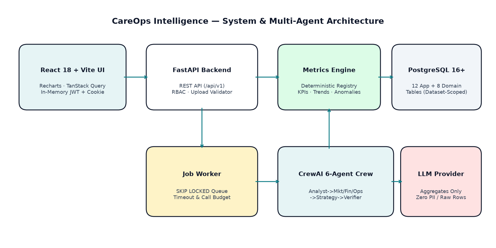

# MediOps Intelligence

**AI-Powered Hospital Operations & Performance Intelligence.**
Full-stack multi-agent business operations and decision intelligence platform on `data/01_Healthcare.xlsx` (May 1 – Oct 31, 2026, INR).

**Mandatory Stack:** React 18 + Vite · Python 3.12 + FastAPI · CrewAI 1.15.41 + LLM · PostgreSQL 16+ · JWT (`argon2id` + rotating `httpOnly` refresh cookie) · Docker · GitHub Actions CI.

### Live Production Links
- **Live Deployed Web App (Netlify):** https://mediops-intelligence.netlify.app
- **Live Deployed API Health & Readiness:** https://mediops-intelligence.netlify.app/api/v1/health · https://mediops-intelligence.netlify.app/api/v1/ready
- **Live Deployed Swagger / OpenAPI Docs:** https://mediops-intelligence.netlify.app/docs (Spec: https://mediops-intelligence.netlify.app/openapi.json)
- **Render Full-Stack Blueprint (Postgres + Docker API + Worker + Web):** https://dashboard.render.com/blueprint/new?repo=https://github.com/niravpatel22/MutiAgentHealth
- **GitHub Repository & Green CI Pipeline:** https://github.com/niravpatel22/MutiAgentHealth



---

## 1. Core Principles

1. **Numbers come from code, never from the LLM.** Every KPI, trend, breakdown, and anomaly is computed deterministically by [`backend/app/metrics/registry.py`](backend/app/metrics/registry.py).
2. **Agents receive aggregates only.** Raw patient rows, names, and full phone numbers are never sent to the LLM, API responses, or logs.
3. **Two-layer verification & hallucination control.** Every Strategy report is audited by both the deterministic Python verifier ([`backend/app/agents/verifier.py`](backend/app/agents/verifier.py)) and the CrewAI Verification Agent, with up to 2 revision loops.
4. **Human-in-the-Loop (HITL) governance.** Consequential recommendations (`budget`, `staffing`, `purchasing`, `vendor`) from approved reports require explicit `manager` or `admin` approval and are logged in `approval_history`; nothing executes automatically.
5. **Honest data limits.** The system explicitly reports where the dataset cannot support a conclusion (no marketing spend/ROI, no amount-paid/collections column, no inventory consumption forecast).

---

## 2. Dataset Golden Numbers (`data/01_Healthcare.xlsx`, Verified in Automated Tests)

| Metric | Key | Golden Value |
|---|---|---|
| Total Appointments | `appointments.total` | **2,500** (`1,782` Completed · `251` Scheduled · `264` Cancelled · `203` No Show) |
| Completion / No-Show Rate (excl. Scheduled) | `appointments.completion_rate` / `no_show_rate` | **79.24%** / **9.03%** |
| Average Wait Time | `appointments.avg_wait_minutes` | **49.92 minutes** |
| Invoiced Net Revenue (`Billing.net_amount` only) | `finance.net_revenue` | **₹22,256,456.76** (`₹2,22,56,457`) |
| Total Expenses (all statuses) | `finance.total_expenses_all_statuses` | **₹52,970,142.83** |
| Approved / Pending / Rejected Expenses | `finance.approved_expenses` / `pending` / `rejected` | **₹26,551,788** / **₹12,228,224** / **₹14,190,131** |
| Approved-Expense Margin | `finance.approved_margin` (`_pct`) | **-₹4,295,331.32** (**-19.30%**) |
| Invoices by Payment Status | `finance.invoice_count` | **896** Paid · **460** Partially Paid · **444** Pending |
| Low-Stock / Expiring ≤ 90d / Duplicate Batches | `inventory.low_stock_items` / `expiring_90d_items` / `duplicate_batch_count` | **111** / **20** / **6** |

---

## 3. Quick Start

### Option A: One-Command Docker Stack

```bash
cp backend/.env.example backend/.env
# Set JWT_SECRET, ADMIN_EMAIL, ADMIN_PASSWORD (and optional LLM_API_KEY) in backend/.env
docker compose up --build
```

- **Frontend UI:** http://localhost:5173
- **Backend API & Swagger Docs:** http://localhost:8000/docs
- **Health & Readiness:** http://localhost:8000/api/v1/health · http://localhost:8000/api/v1/ready

### Option B: Native Local Development (Windows / Linux / macOS)

```powershell
# 1. Install locked backend (Python 3.12 via uv) and frontend dependencies
./scripts/tasks.ps1 install        # or: make install

# 2. Run Alembic migrations, seed initial admin, and load data/01_Healthcare.xlsx
./scripts/tasks.ps1 migrate        # or: make migrate
./scripts/tasks.ps1 seed-admin     # or: make seed-admin
./scripts/tasks.ps1 load-sample-dataset

# 3. Start API (http://localhost:8000/docs) and React frontend (http://localhost:5173)
./scripts/tasks.ps1 api
./scripts/tasks.ps1 web
```

---

## 4. Repository Structure

```text
├── backend/
│   ├── app/
│   │   ├── main.py                # FastAPI app factory, security headers, nonce Swagger UI
│   │   ├── cli.py                 # seed-admin & load-sample-dataset CLI
│   │   ├── core/                  # config, argon2id/JWT security, structlog redaction, errors, rate limit
│   │   ├── db/                    # SQLAlchemy 2.0 session, base, application & domain models
│   │   ├── schemas/               # Pydantic v2 request/response & structured agent output schemas
│   │   ├── api/v1/                # auth, profile, datasets, analytics, analyses, reports,
│   │   │                          # recommendations, chat, admin, health routers
│   │   ├── services/              # business logic (independent of HTTP and CrewAI)
│   │   ├── ingestion/             # hardened xlsx/csv reader, validator/quarantine, transactional loader
│   │   ├── metrics/               # deterministic KPI, monthly series, breakdown & anomaly registry
│   │   ├── agents/                # CrewAI 6 agents, chained tasks, read-only tools, verifier, chat Q&A
│   │   ├── worker/                # PostgreSQL FOR UPDATE SKIP LOCKED background worker
│   │   └── reports/               # ReportLab + matplotlib reproducible PDF builder
│   ├── alembic/                   # migrations 0001_initial_app & 0002_domain_healthcare
│   ├── tests/                     # 31 backend tests (90% coverage, golden values, RBAC/IDOR, verifier)
│   ├── Dockerfile  pyproject.toml  uv.lock  .env.example
├── frontend/
│   ├── src/                       # app/, pages/, components/, features/auth/, api/, styles/, utils/
│   ├── tests/                     # Vitest + React Testing Library component tests
│   ├── Dockerfile  nginx.conf  vercel.json  package.json  vite.config.js  .env.example
├── data/01_Healthcare.xlsx        # synthetic 6-month healthcare dataset (7,100 rows)
├── docs/                          # ARCHITECTURE.md, architecture.png/.mmd, API.md, SECURITY.md,
│                                  # DEPLOYMENT.md, DECISIONS.md, DEMO_SCRIPT.md, sample_report.pdf
├── .github/workflows/ci.yml       # lint, tests, pip-audit, npm audit, gitleaks, Docker build
├── docker-compose.yml  render.yaml  Makefile  scripts/tasks.ps1  HANDOVER.md
```

---

## 5. Testing & Quality Gates

```powershell
./scripts/tasks.ps1 lint           # Ruff, Black, ESLint (--max-warnings=0), Prettier
./scripts/tasks.ps1 test           # pytest (--cov=app) + Vitest

# Opt-in live LLM smoke test (when LLM_API_KEY is configured):
cd backend && uv run pytest -m live_llm
```

---

## 6. Documentation Index

- [Architecture & Diagrams](docs/ARCHITECTURE.md) ([`docs/architecture.png`](docs/architecture.png))
- [API Reference Summary](docs/API.md) (Interactive Swagger at `/docs`)
- [Security & Threat Model](docs/SECURITY.md)
- [Cloud Deployment Guide](docs/DEPLOYMENT.md)
- [Engineering Decisions Log](docs/DECISIONS.md)
- [6–8 Minute Live Demo Script](docs/DEMO_SCRIPT.md)
- [Sample Generated PDF Report](docs/sample_report.pdf)
- [Client Handover Checklist](HANDOVER.md)
