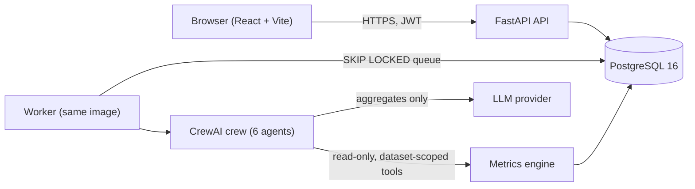

# Architecture

> Stub (Phase 0). Completed in Phase 7 with the full Mermaid architecture diagram (also exported
> to `architecture.png`), ERD, agent workflow, and sequence diagrams.

## Planned components

| Layer | Responsibility |
|---|---|
| `api/v1` | HTTP routing, auth dependencies, Pydantic contracts |
| `services/` | Business logic, no HTTP or CrewAI imports |
| `ingestion/` | Read, validate, clean, quarantine, load uploads |
| `metrics/` | Single source of truth for every figure |
| `agents/` | CrewAI agents, tasks, tools, deterministic verifier |
| `worker/` | PostgreSQL-backed job runner for analyses |
| `reports/` | Reproducible PDF builder |
