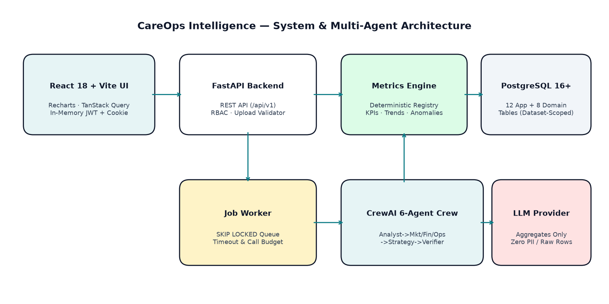
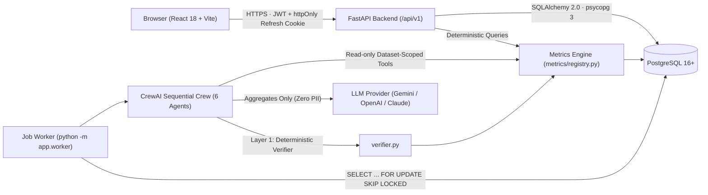
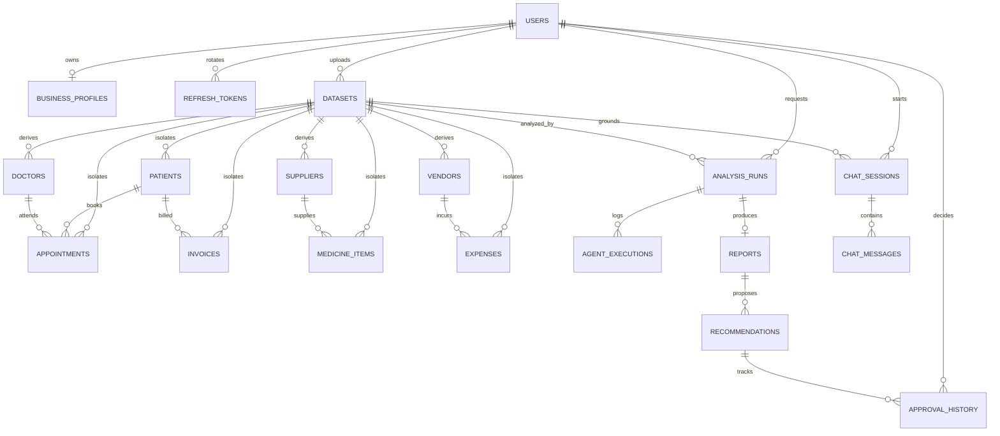
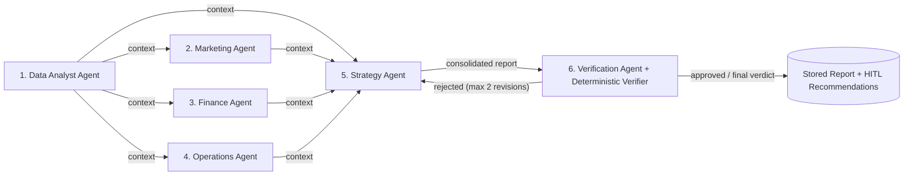
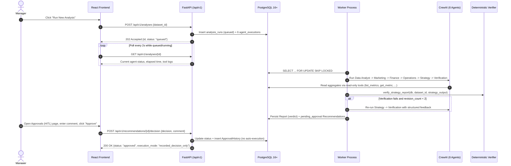

# Architecture — MediOps Intelligence

**AI-Powered Smart Business Operations & Decision Intelligence System: Healthcare Edition**

## 1. High-Level System Architecture

### Separation of Responsibilities

| Layer | Module | Responsibility |
|---|---|---|
| **Presentation** | `frontend/src/` | React 18 + Vite SPA, Recharts visualizations with accessible table fallbacks, in-memory JWT + cookie refresh client |
| **API Gateway & RBAC** | `backend/app/api/v1/` | Versioned REST endpoints, Pydantic v2 contracts, FastAPI dependencies enforcing role and object-level (IDOR) authorization |
| **Business Services** | `backend/app/services/` | Domain orchestration independent of HTTP and CrewAI |
| **Ingestion Pipeline** | `backend/app/ingestion/` | Magic-byte signature checks, macro/formula rejection, cleaning, row quarantine with reasons, dimension derivation, transactional bulk load |
| **Metrics Engine** | `backend/app/metrics/registry.py` | **Single source of truth** for all 27 KPIs, monthly series, dimensional breakdowns, and statistical anomalies |
| **Multi-Agent Layer** | `backend/app/agents/` | Six CrewAI agents, chained sequential tasks, 5 read-only dataset-scoped tools, deterministic verifier (`verifier.py`), and Q&A chat assistant |
| **Background Worker** | `backend/app/worker/` | PostgreSQL-backed `SELECT ... FOR UPDATE SKIP LOCKED` job runner executing analyses asynchronously |
| **PDF Builder** | `backend/app/reports/pdf_builder.py` | Reproducible ReportLab + matplotlib PDF generator from stored report and metrics snapshot data |

---

## 2. Database Entity-Relationship Diagram (ERD)

---

## 3. Six-Agent CrewAI Sequential Workflow & Context Chaining

---

## 4. Sequence Diagram: Analysis Run, Verification, & HITL Approval

---

## 5. Query Performance & Index Verification (`EXPLAIN`)

Verified against PostgreSQL on the 7,100-row `01_Healthcare.xlsx` dataset:

- `EXPLAIN SELECT count(*) FROM appointments WHERE dataset_id = :d AND month IS NOT NULL`
  → `Index Only Scan using ix_appointments_dataset_month on appointments (cost=0.28..64.03 rows=2500 width=0)`
- Measured end-to-end HTTP response times (target `< 300 ms`):
  - `GET /api/v1/datasets/{id}/kpis`: **222.3 ms**
  - `GET /api/v1/datasets/{id}/trends`: **225.8 ms**
  - `GET /api/v1/datasets/{id}/breakdowns/department`: **84.5 ms**
